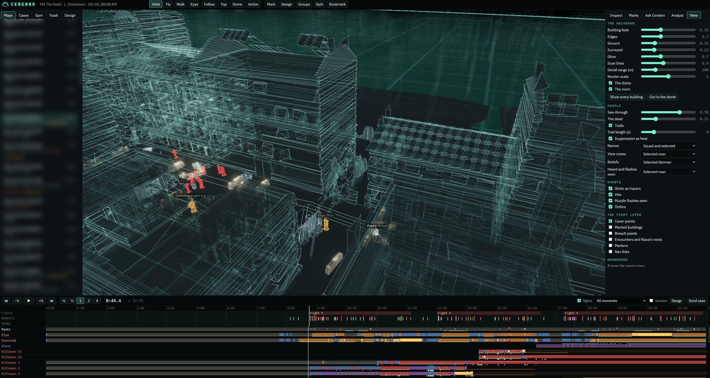
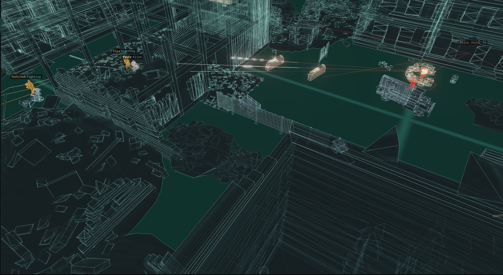
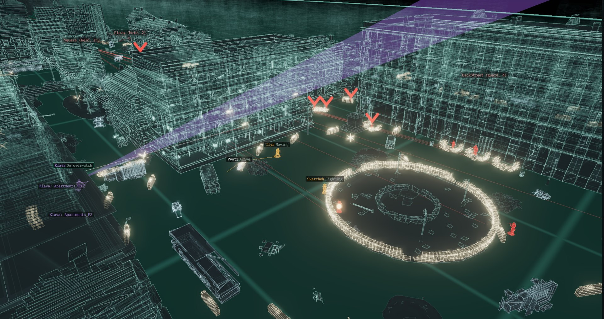
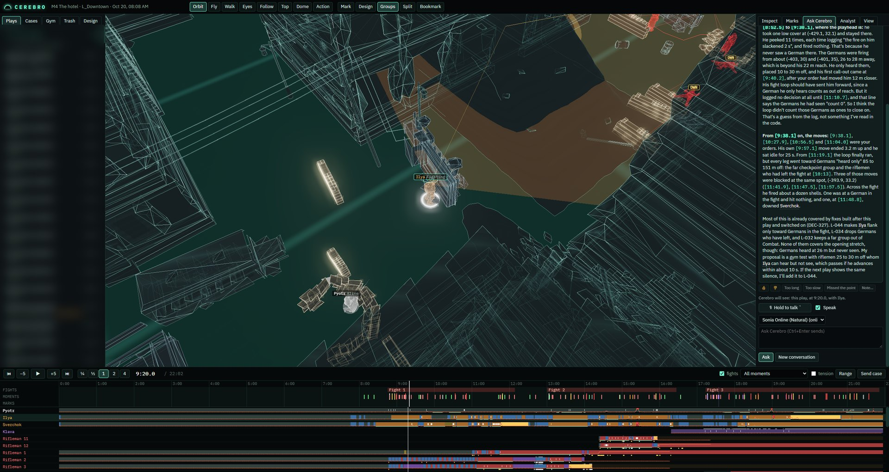
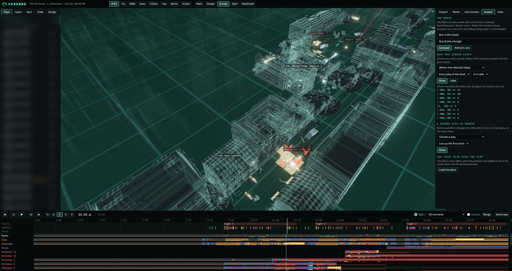
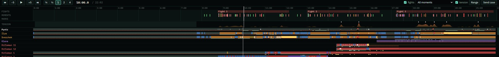

# CEREBRO
### *a combat lab inside a glass dome*

**Replay a firefight as a hologram, and ask why it went the way it did.**

*Built for a game in development · runs locally · Three.js + Python*

---

> *Every shot, every order, every man's idea of where the enemy was, and the reason he did what he did.*

## What it is

I'm making a first-person game about the Battle of Stalingrad, and its fights are run by AI: German soldiers who flank, suppress and fall back, and companions who follow orders. When a fight goes wrong, "it felt off" isn't enough to fix anything.

Cerebro is the tool I built to see inside them.

Every playtest is recorded. Cerebro takes the recording, stands the level up as a glowing **hologram under a glass dome**, and lets me replay the fight from any angle, with every soldier's **state, view cone, beliefs and decisions** drawn right on him.

## What you can do in it

- **Fly through a fight.** Orbit, fly, walk the ground at eye height, look through any man's eyes, follow one soldier, or watch from the dome. A camera mode follows the action to wherever the shooting is.
- **See what each man knew.** The enemy's *beliefs* are drawn as fuzzy spheres coloured by where the idea came from (saw, heard, told, hit, flash) and fading with age. You can watch a soldier shoot at where he *thought* you were.
- **Read the timeline.** Fights, downs, orders, flashes and quiet stretches, with a lane for every man showing his state, cover, suppression and who actually heard an order, and why not.
- **Mark it up.** Drop a note on a spot, a building or a man, and send the range to Cerebro as a **case**.
- **Compare changes with numbers.** Run the same fight dozens of times with fixed seeds, with and without a change, and compare flanks attempted, time the player spent pinned, shots per kill and more, each with its spread.
- **Find patterns across plays.** Heat maps of where men died, and an earlier play drawn as ghosts over a later one to show what a change did.
- **Feel the pacing.** A tension curve under the timeline: fire coming your way, suppression, close calls, health lost, and the quiet stretches between.
- **Design in the hologram.** Place cover, walls and German groups right in the hologram while sight lines, flanking angles and shout ranges update live.

## Ask Cerebro

Cerebro is also the combat designer. Ask it a question about the play on screen:

> *Why did Ilya keep leaving cover?*
> *What went wrong in that second fight?*

It reads the recording, your marks and the combat rules I've written, then answers with times that move the playhead and names that select the man. Over many reviews it keeps a **ledger of every proposal** and checks whether each change actually helped.

*Ask Cerebro runs on Claude.*

## Screenshots

| | |
|---|---|
|  |  |
| *A firefight up close: tracers, sight lines, who's fighting* | *What each man can see: a sniper's view cone over the square* |
|  |  |
| *Ask Cerebro: why a companion kept moving instead of firing* | *Where men died, across every play of the level* |

*The timeline: fights, the tension curve, and a lane for every man*

## How it works

- **A recorder** inside the game writes a small, open, line-by-line file: the game describes itself once, then streams positions, aim, states, shots, hits, sounds heard and orders. It has no game-specific code in it, so it could describe a different game.
- **A level exporter** simplifies every building, wall and piece of cover into the hologram. The whole hotel level is about 8,700 pieces and 287,000 triangles, and loads in seconds.
- **A local app**: a plain-Python server on your own machine (nothing leaves it) and a Three.js front end.
- **A bench** runs any fight headless, many times over, to measure a change instead of guessing.

## Status

Built and in regular use since October 2026. It's a tool made for one game, and I'm working on pulling it out so it can describe any game.

This repo is a **showcase only**. The code isn't public.

## Follow along

- **X:** [@CoderofVibes](https://x.com/CoderofVibes)
- **The game behind it:** [Domoy](https://github.com/CoderofVibes/Domoy-DevLog)

---

*Built to find out why.*

